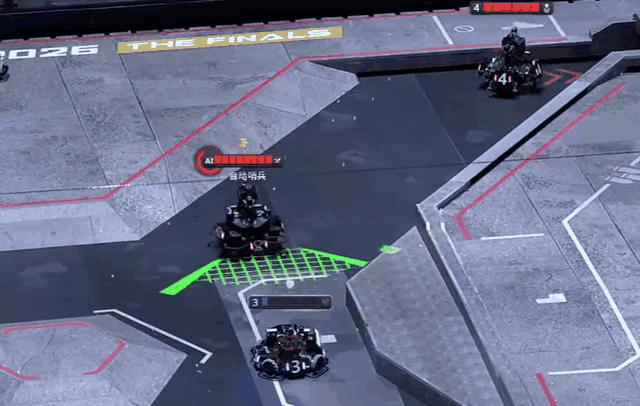
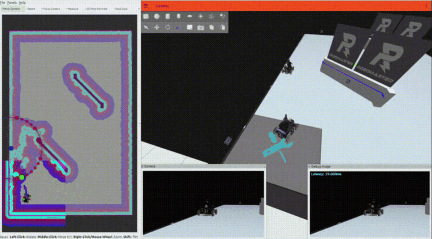

# chase — 哨兵追击攻击点计算包

`chase` 是 RoboMaster 哨兵导航（`pb2025_sentry_nav`）中的一个 ROS 2 功能包，负责在**全局代价地图**上实时解算追击**敌方机器人（步兵 / 英雄）**时应前往的**攻击位置**（chase point），并将该点发布给上层决策使用。

## 追击演示

**实车追击**



**仿真追击与可视化**



## 在整套系统中的位置

```
电控
 │  /track_target：雷达朝向与枪管朝向的 yaw 差、自瞄索敌锁定距离
 ▼
chase（本包） ──► /chase_point：计算出的合适追击攻击点
                     │
                     ▼
              决策包：综合态势决策，决定是否前往 / 前往哪个点
```

- **上游**：电控通过 `/track_target` 下发敌方相对信息（雷达/枪管 yaw 差、自瞄锁定距离）；
- **下游**：本包解算出的 `/chase_point` 交给**决策包**，由决策层决定最终的追击行为。

## 功能概述

当敌方目标被识别/追踪后，本节点会：

1. 接收敌方目标追踪信息（`/track_target`）与全局代价地图；
2. 通过 TF 将敌方位置变换到代价地图坐标系下；
3. 以敌方位置为中心、`attack_radius` 为半径，按扇区（`num_sectors`）生成一圈**候选攻击点**；
4. 结合代价地图过滤掉被障碍物占据 / 成本过高的**不可行点**；
5. 依据机器人自身位置从可行点中选出**最佳攻击点**；
6. 发布 `/chase_point` 供上层导航使用，并支持 RViz 可视化调试。

> 无目标、未收到代价地图或坐标变换失败时，节点会兜底发布 `(0, 0)`。

## 话题接口

| 方向 | 话题 | 消息类型 | 说明 |
|---|---|---|---|
| 订阅 | `/track_target` | `base_interfaces_demo/msg/Target` | 电控下发的敌方相对信息：雷达朝向与枪管朝向的 yaw 差、自瞄索敌锁定距离 |
| 订阅 | `global_costmap/costmap` | `nav_msgs/msg/OccupancyGrid` | 全局代价地图（话题名可用参数修改） |
| 发布 | `/chase_point` | `geometry_msgs/msg/Point` | 解算出的追击攻击点 |
| 发布 | `/chase_markers` | `visualization_msgs/msg/MarkerArray` | 候选点 / 可行点 / 最优点的可视化（可关闭） |

同时监听 TF（`tf2`），需要 `map → 敌方坐标系` 与 `map → robot_base_frame` 的变换可用。

## 参数

默认值见 `config/chase.yaml`：

| 参数 | 默认值 | 说明 |
|---|---|---|
| `chase.attack_radius` | `3.0` | 攻击半径（米）：候选点与敌方保持的距离 |
| `chase.num_sectors` | `12` | 候选点扇区数量，越大候选越密、计算越重 |
| `chase.cost_threshold` | `50` | 代价地图可行点成本阈值，超过视为不可行 |
| `chase.costmap_topic` | `global_costmap/costmap` | 代价地图话题名 |
| `chase.robot_base_frame` | `chassis` | 机器人基座坐标系 |
| `chase.transform_tolerance` | `0.5` | TF 变换容忍时间（秒） |
| `chase.max_visualization_distance` | `6.0` | 可视化最大距离（米） |
| `chase.marker_scale_base` | `0.2` | 可视化 marker 基础尺寸 |
| `chase.visualize` | `true` | 是否启用 RViz 可视化发布 |

## 运行

```bash
# 构建
colcon build --packages-select chase
source install/setup.bash

# 启动（自动加载 config/chase.yaml，并绑定 CPU 8）
ros2 launch chase chase_launch.py
```

启动后可在 RViz 中添加 `MarkerArray`（话题 `/chase_markers`）查看候选点与最终追击点，配合导航模块订阅 `/chase_point` 使用。

## 依赖

- `rclcpp` / `nav2_util` / `launch` / `launch_ros`
- `geometry_msgs` / `nav_msgs` / `std_msgs` / `visualization_msgs`
- `tf2` / `tf2_ros` / `tf2_geometry_msgs`
- `base_interfaces_demo`（本工作空间内的自定义消息包，定义 `msg/Target`）

## 目录结构

```
chase/
├── CMakeLists.txt
├── package.xml
├── config/
│   └── chase.yaml            # 参数配置
├── launch/
│   └── chase_launch.py       # 启动文件
├── include/
│   └── calculate_attack_pose.hpp   # 节点类声明
└── src/
    └── calculate_attack_pose.cpp   # 节点实现（408 行）
```

## 核心实现思路（备忘）

- 节点类 `qiqi2026_chase::CalculateAttackPose`，ROS 2 定时器 200 ms 周期驱动；
- 候选点生成 → 代价过滤 → 最优选择 三段式逻辑，接口分别在
  `generateCandidatePoints()` / `filterFeasiblePoints()` / `selectBestPoint()`，
  便于后续替换为更优的选点策略（如考虑朝向、火力范围、敌方运动预测）。
